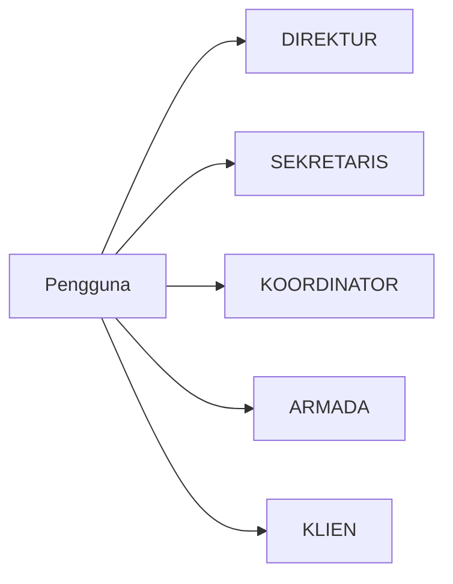
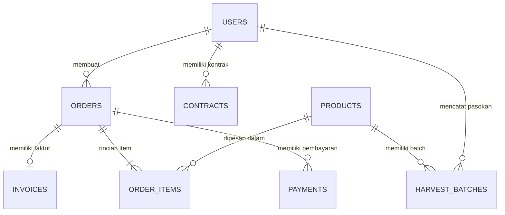

# PANDUAN BACKEND AGROORDER GPA
### Dokumentasi Teknis Ringkas, Padat, & Mudah Dipahami Pemula

> **Aplikasi:** AgroOrder GPA (Sistem Rantai Pasok Pertanian & E-Commerce B2B)  
> **Framework:** Laravel 12.0 (PHP 8.2+)  
> **Database:** Relasional (MySQL / SQLite)  
> **Testing:** 184 Tests Passed (100% Lolos)  
> **Tujuan:** Menjelaskan seluruh alur sistem, fungsi kode, arsitektur database, dan jawaban sidang UKK secara langsung ke inti persoalan (*to the point*).

---

## 📑 DAFTAR ISI

1. [Bab 1: Alur Kerja Backend (Request Lifecycle)](#bab-1-alur-kerja-backend-request-lifecycle)
2. [Bab 2: Struktur Folder & Fungsi Berkas](#bab-2-struktur-folder--fungsi-berkas)
3. [Bab 3: 5 Role Pengguna & Hak Akses (RBAC)](#bab-3-5-role-pengguna--hak-akses-rbac)
4. [Bab 4: Database & 10 Tabel Utama](#bab-4-database--10-tabel-utama)
5. [Bab 5: Bedah Kode Inti (Service Layer)](#bab-5-bedah-kode-inti-service-layer)
   * [5.1 StockService: Alokasi Stok FIFO & Anti-Minus](#51-stockservice-alokasi-stok-fifo--anti-minus)
   * [5.2 OrderService: Penomoran Unik, Invoice, & Transaksi ACID](#52-orderservice-penomoran-unik-invoice--transaksi-acid)
   * [5.3 TataKelolaService: Master Freeze & Audit Log](#53-tatakelolaservice-master-freeze--audit-log)
   * [5.4 ProductService & ArmadaService](#54-productservice--armadaservice)
   * [5.5 Layanan Cetak Dokumen (Surat Jalan, Faktur, Laporan, Retur)](#55-layanan-cetak-dokumen-surat-jalan-faktur-laporan-retur)
6. [Bab 6: Alur Transaksi dari Hulu ke Hilir](#bab-6-alur-transaksi-dari-hulu-ke-hilir)
7. [Bab 7: Form Request & Enum](#bab-7-form-request--enum)
8. [Bab 8: Keamanan Sistem & Penanganan Tabrakan Data](#bab-8-keamanan-sistem--penanganan-tabrakan-data)
9. [Bab 9: Pengujian Otomatis (184 Tests)](#bab-9-pengujian-otomatis-184-tests)
10. [Bab 10: Kamus Kodingan Laravel](#bab-10-kamus-kodingan-laravel)
11. [Bab 11: Tanya Jawab Sidang UKK (To The Point)](#bab-11-tanya-jawab-sidang-ukk-to-the-point)

---

## Bab 1: Alur Kerja Backend (Request Lifecycle)

Saat pengguna mengklik tombol di web, berikut alur perjalanannya:

```
[Browser Klien] 
       │ (1. Kirim HTTP Request, misal: POST /klien/pesanan)
       ▼
[routes/web.php] 
       │ (2. Mencocokkan URL & lempar ke Controller)
       ▼
[Middleware] 
       │ (3. Cek login & cek Role: apakah user berhak lewat?)
       ▼
[Form Request] 
       │ (4. Validasi input: apakah data kosong/minus?)
       ▼
[Controller] 
       │ (5. Pengatur lalu lintas: memanggil Service Layer)
       ▼
[Service Layer] 
       │ (6. Otak logika: hitung stok, buat invoice, kunci transaksi)
       ▼
[Model Eloquent] 
       │ (7. Berkomunikasi dengan database)
       ▼
[Database (MySQL)] 
       │ (8. Simpan/ambil data secara fisik)
       ▼
[Blade View / JSON] 
       │ (9. Bungkus data ke tampilan HTML/JSON)
       ▼
[Layar Pengguna]
```

**Prinsip Kerja:**
* **Route:** Resepsionis penunjuk jalan.
* **Middleware:** Satpam pemeriksa login & role.
* **Controller:** Pelayan (hanya menerima request dan memberi respon, tidak memproses rumus rumit).
* **Service:** Koki dapur (tempat seluruh logika bisnis, rumus hitungan, dan transaksi ditaruh).
* **Model:** Jembatan ke tabel database.

---

## Bab 2: Struktur Folder & Fungsi Berkas

Folder penting di [agroOrderGPA](file:///d:/UKK/agroOrderGPA):

| Folder / Berkas | Fungsi Utama |
| :--- | :--- |
| `app/Http/Controllers/` | Menerima request pengguna dan mengembalikan view atau JSON. Dibagi per role (`Sekretaris`, `Klien`, `Armada`, `Prints`). |
| `app/Services/` | **Pusat logika bisnis.** Menghitung stok, memotong kuota panen, membuat invoice, mencetak PDF. |
| `app/Models/` | Class penghubung ke database (`Order`, `User`, `Product`, `HarvestBatch`, `Invoice`, `Payment`). |
| `app/Enums/` | Daftar pilihan status baku yang dikunci kaku (`OrderStatus`, `PaymentMethod`). Bebas typo. |
| `app/Http/Requests/` | Aturan validasi form input pengguna (menolak data jika kosong/salah tipe). |
| `app/Http/Resources/` | Mengubah format data model menjadi array rapi untuk tabel frontend / Alpine.js. |
| `database/migrations/` | File cetak biru pembuatan tabel database. |
| `database/seeders/` | Data awal bawaan (akun demo, katalog sayur, kontrak mitra). |
| `routes/web.php` | Seluruh daftar alamat URL aplikasi dan middleware pengamannya. |
| `tests/Feature/` | 184 skrip penguji otomatis untuk mengecek bug sistem. |

---

## Bab 3: 5 Role Pengguna & Hak Akses (RBAC)

Aplikasi memiliki 5 role pengguna dengan tugas spesifik:



1. **DIREKTUR**
   * Melihat performa omzet dan laporan piutang koperasi.
   * Mengatur plafon kredit (*credit limit*) mitra B2B.
   * Mengaktifkan sakelar **Master Freeze** (penghentian darurat seluruh transaksi).

2. **SEKRETARIS**
   * Memverifikasi PO pesanan masuk (`/sekretaris/verifikasi`).
   * Menginput pesanan manual via telepon/WA (`/sekretaris/pesanan-manual`).
   * Memvalidasi bukti transfer pembayaran bank (`/sekretaris/pembayaran`).
   * Menerbitkan nomor Surat Jalan dan menugaskan supir (`/sekretaris/surat-jalan`).
   * Memantau serah terima dan memproses retur barang rusak (`/sekretaris/monitoring-pod`).

3. **KOORDINATOR LAPANGAN**
   * Mencatat timbangan hasil panen petani yang masuk ke gudang (`/koordinator/stok`).
   * Menginput batch panen dengan tanggal panen, grade mutu, dan kuantitas awal (kg).

4. **ARMADA (SUPIR)**
   * Melihat daftar tugas pengantaran sayur aktif (`/armada/tugas`).
   * Memulai rute pengantaran menggunakan mobil box pendingin.
   * Mengunggah foto tanda terima fisik (PoD) dan mencatat kg retur jika ada sayur rusak (`/armada/bukti-terima`).

5. **KLIEN (RESTO / HOTEL / UMUM)**
   * Memilih sayuran di katalog dan keranjang belanja.
   * Menikmati harga kontrak flat jika berstatus mitra B2B Kontrak.
   * Tracking 5 tahapan pesanan secara real-time.
   * Mengunggah struk bukti transfer.

---

## Bab 4: Database & 10 Tabel Utama

Aplikasi menggunakan 10 tabel relasional yang saling terhubung:



### Rincian 10 Tabel:

1. **`users`**: Data akun pengguna (nama, email, password bcrypt, phone, role, client_type, credit_limit, credit_used).
2. **`products`**: Katalog komoditas sayur (sku, name, unit 'kg', grade, base_price, is_active).
3. **`harvest_batches`**: Pasokan panen fisik di gudang (product_id, supplier_name, batch_date, initial_quantity, available_quantity, inputted_by).
4. **`contracts`**: Perjanjian harga kontrak B2B (user_id, product_id, fixed_price_per_kg, committed_volume_per_cycle, top_days, status).
5. **`orders`**: Dokumen pesanan utama (order_number, user_id, status, subtotal, tax_amount, shipping_cost, grand_total, driver_id, vehicle_plate_number, surat_jalan_number, pod_photo_url).
6. **`order_items`**: Rincian sayur yang dibeli per pesanan (order_id, product_id, ordered_qty, unit_price, subtotal_price, returned_weight, return_reason).
7. **`invoices`**: Faktur tagihan komersial (invoice_number, order_id, user_id, issue_date, due_date, grand_total, status).
8. **`payments`**: Transaksi pembayaran uang (order_id, invoice_id, amount, payment_channel, proof_url, status, verified_by).
9. **`governance_logs`**: Log audit catatan perubahan kebijakan direktur (lengkap dengan SHA-256 hash anti-tamper).
10. **`settings`**: Pengaturan global (rekening bank resmi, jam operasional, tarif flat ongkir).

---

## Bab 5: Bedah Kode Inti (Service Layer)

Semua rumus dan operasi database berat ditaruh di `app/Services/`.

### 5.1 StockService: Alokasi Stok FIFO & Anti-Minus
Berkas: [`app/Services/StockService.php`](file:///d:/UKK/agroOrderGPA/app/Services/StockService.php)

#### 1. Menghitung Total Stok Tersedia
```php
public function getAvailableStock(int $productId): float
{
    return (float) HarvestBatch::where('product_id', $productId)
        ->where('available_quantity', '>', 0)
        ->sum('available_quantity');
}
```
* **Artinya:** Menjumlahkan sisa stok (`available_quantity`) dari seluruh batch yang belum habis (`> 0`) untuk produk terkait.

#### 2. Memotong Stok Secara FIFO (First In, First Out)
```php
public function allocateStock(int $productId, float $neededQty): void
{
    // Ambil batch dari tanggal panen terlama (FIFO) & gembok baris datanya
    $batches = HarvestBatch::where('product_id', $productId)
        ->where('available_quantity', '>', 0)
        ->orderBy('batch_date', 'asc') // Panen terlama keluar duluan
        ->orderBy('id', 'asc')
        ->lockForUpdate() // Kunci baris agar tidak direbut transaksi lain
        ->get();

    $remainingQty = $neededQty;

    foreach ($batches as $batch) {
        if ($remainingQty <= 0) {
            break; // Kebutuhan terpenuhi, stop perulangan
        }

        $available = (float) $batch->available_quantity;
        $deductQty = min($available, $remainingQty);

        $batch->decrement('available_quantity', $deductQty);
        $remainingQty -= $deductQty;
    }

    // Jika stok fisik gudang kurang dari kebutuhan, batalkan transaksi
    if ($remainingQty > 0) {
        throw new Exception("Stok fisik komoditas di gudang tidak mencukupi untuk dialokasikan.");
    }
}
```

* **Simulasi Nyata:**
  * Butuh: **50 kg**.
  * Ada **Batch A (30 kg)** dan **Batch B (40 kg)**.
  * Putaran 1: Batch A terpotong 30 kg (sisa Batch A = 0 kg). Sisa butuh = 20 kg.
  * Putaran 2: Batch B terpotong 20 kg (sisa Batch B = 20 kg). Sisa butuh = 0 kg.
  * Selesai tanpa ada stok minus.

---

### 5.2 OrderService: Penomoran Unik, Invoice, & Transaksi ACID
Berkas: [`app/Services/OrderService.php`](file:///d:/UKK/agroOrderGPA/app/Services/OrderService.php)

#### 1. Penomoran Dokumen Anti-Tabrakan (`Cache::lock`)
```php
public function generateOrderNumber(): string
{
    $prefix = 'ORD-GPA-' . date('Ym') . '-';

    return Cache::lock('order_number_sequence_lock', 5)->block(3, function () use ($prefix) {
        $lastOrder = Order::where('order_number', 'LIKE', $prefix . '%')
            ->orderBy('id', 'desc')
            ->first();

        $nextSequence = $lastOrder ? ((int) substr($lastOrder->order_number, -4)) + 1 : 1;
        $newOrderNumber = $prefix . str_pad((string) $nextSequence, 4, '0', STR_PAD_LEFT);

        while (Order::where('order_number', $newOrderNumber)->exists()) {
            $nextSequence++;
            $newOrderNumber = $prefix . str_pad((string) $nextSequence, 4, '0', STR_PAD_LEFT);
        }

        return $newOrderNumber;
    });
}
```
* **Fungsi:** Mengunci proses nomor selama beberapa milidetik. Mencegah 2 orang yang checkout bersamaan mendapatkan nomor invoice yang sama (*duplicate entry*).

#### 2. Persetujuan Pesanan & Penerbitan Faktur Otomatis
```php
public function approveOrder(int $orderId, int $secretaryId, ?float $manualShippingCost = null): Order
{
    return DB::transaction(function () use ($orderId, $secretaryId, $manualShippingCost) {
        $order = Order::with('orderItems')->lockForUpdate()->findOrFail($orderId);

        // 1. Potong stok gudang untuk setiap item
        foreach ($order->orderItems as $item) {
            $this->stockService->allocateStock($item->product_id, (float) $item->ordered_qty);
        }

        // 2. Terbitkan Invoice otomatis jika belum ada
        if (!$order->invoice_id) {
            $invoice = Invoice::create([
                'order_id'       => $order->id,
                'user_id'        => $order->user_id,
                'invoice_number' => $this->generateInvoiceNumber(),
                'issue_date'     => now()->toDateString(),
                'due_date'       => now()->addDays(30)->toDateString(),
                'grand_total'    => $order->grand_total,
                'status'         => 'UNPAID',
            ]);
            $order->invoice_id = $invoice->id;
        }

        $order->status = OrderStatus::MENUNGGU_PEMBAYARAN->value;
        $order->verified_by = $secretaryId;
        $order->save();

        return $order;
    });
}
```
* **Fungsi `DB::transaction()`:** Memastikan alokasi stok dan pembuatan invoice berjalan sukses bersamaan. Jika salah satu gagal, seluruh perubahan dibatalkan (*rollback*).

---

### 5.3 TataKelolaService: Master Freeze & Audit Log
Berkas: [`app/Services/TataKelolaService.php`](file:///d:/UKK/agroOrderGPA/app/Services/TataKelolaService.php)

* **Master Freeze:** Mengunci total transaksi belanja se-koperasi saat kondisi darurat atau audit stok opname.
* **Audit Log SHA-256:** Menyimpan log perubahan plafon kredit dan rekening ke berkas JSON dengan hash digital anti-manipulasi.

---

### 5.4 ProductService & ArmadaService
* [`ProductService.php`](file:///d:/UKK/agroOrderGPA/app/Services/ProductService.php): Mengelola data produk, hitung rata-rata harga pasar, dan cegah hapus produk yang masih memiliki riwayat transaksi.
* [`ArmadaService.php`](file:///d:/UKK/agroOrderGPA/app/Services/ArmadaService.php): Mengelola penugasan supir armada, nomor pelat mobil pendingin, dan jadwal rute.

---

### 5.5 Kontroler Cetak Dokumen Resmi (`app/Http/Controllers/Prints`)
1. [`PrintSuratJalanController.php`](file:///d:/UKK/agroOrderGPA/app/Http/Controllers/Prints/PrintSuratJalanController.php): Cetak Surat Jalan A4 resmi pengantaran logistik.
2. [`PrintFakturController.php`](file:///d:/UKK/agroOrderGPA/app/Http/Controllers/Prints/PrintFakturController.php): Cetak Faktur Penjualan komersial resmi (tempo 30 hari).
3. [`PrintLaporanController.php`](file:///d:/UKK/agroOrderGPA/app/Http/Controllers/Prints/PrintLaporanController.php): Cetak Rekapitulasi Pembukuan Kas & Tonase Penjualan, serta ekspor CSV/Excel.
4. [`PrintBeritaAcaraReturController.php`](file:///d:/UKK/agroOrderGPA/app/Http/Controllers/Prints/PrintBeritaAcaraReturController.php): Cetak Berita Acara Kerusakan / Retur Fisik di lokasi klien.
5. [`PrintStrukThermalController.php`](file:///d:/UKK/agroOrderGPA/app/Http/Controllers/Prints/PrintStrukThermalController.php): Cetak Struk POS Thermal 58mm/80mm untuk pembayaran kasir.

---

## Bab 6: Alur Transaksi dari Hulu ke Hilir

```
1. [Koordinator] Input Timbangan Panen Petani 
   └── Masuk ke harvest_batches (stok gudang bertambah).

2. [Klien] Buat Pesanan di Katalog 
   └── Status: MENUNGGU_VERIFIKASI.

3. [Sekretaris] Verifikasi & Setujui Pesanan
   └── StockService potong stok gudang (FIFO).
   └── Invoice otomatis terbit (Status pesanan: MENUNGGU_PEMBAYARAN).

4. [Klien] Transfer Uang & Upload Struk
   └── Status pembayaran: MENUNGGU_VERIFIKASI.

5. [Sekretaris] Cek Rekening & Sahkan Pembayaran
   └── Status: LUNAS.

6. [Sekretaris] Terbitkan Surat Jalan & Tugaskan Supir
   └── Terbit nomor SJ unik (Status pesanan: SIAP_KIRIM).

7. [Armada] Antar Sayur dengan Mobil Chilled
   └── Status pesanan: DALAM_PENGIRIMAN.

8. [Armada & Klien] Serah Terima di Lokasi Klien
   ├── Jika 100% Bagus: Foto Surat Jalan -> Status: SELESAI.
   └── Jika Ada Rusak: Input Kg Rusak -> Status: SELESAI_CATATAN (Terbit Dokumen Retur).
```

---

## Bab 7: Form Request & Enum

### 1. Form Request (Penyaring Validasi)
* **Letak:** `app/Http/Requests/`.
* **Tujuan:** Memeriksa data sebelum menyentuh Controller.
* **Contoh:** Di `SimpanPesananRequest.php`:
  * `'items' => 'required|array|min:1'` (wajib beli minimal 1 item).
  * `'items.*.qty' => 'required|numeric|min:0.1'` (kuantitas tidak boleh minus atau 0).

### 2. Enum (Tipe Data Baku PHP 8.2)
* **Letak:** `app/Enums/`.
* **Tujuan:** Mengunci nilai status agar tidak ada *typo* (salah ketik).
* **Contoh:** `OrderStatus::MENUNGGU_VERIFIKASI`, `OrderStatus::LUNAS`, `OrderStatus::SELESAI`.

---

## Bab 8: Keamanan Sistem & Penanganan Tabrakan Data

1. **CSRF Protection (`@csrf`):**  
   Mencegah pembajakan form dari website asing melalui token acak.
2. **SQL Injection Prevention:**  
   Semua kueri menggunakan Eloquent ORM & PDO Prepared Statements (input otomatis di-*escape*).
3. **XSS Prevention:**  
   Templating Blade otomatis melakukan sanitasi HTML pada sintaks `{{ $data }}`.
4. **Idempotency Token (Anti-Dobel Klik):**  
   Di `PesananController@store`, klik tombol berkali-kali dalam 15 menit hanya menghasilkan 1 pesanan sah (sisanya diarahkan ke pesanan yang sama via cache key).
5. **Pessimistic Concurrency (`lockForUpdate`):**  
   Menggembok baris database saat proses pemotongan stok berlangsung agar tidak terjadi *overselling*.

---

## Bab 9: Pengujian Otomatis (184 Tests)

Aplikasi memiliki **184 Automated Tests** yang menguji 718 skenario logika dan keamanan.

### Cara Menjalankan Tes:
```bash
php artisan test
```

### Hasil:
```
Tests:    184 passed (718 assertions)
Duration: ~11 detik
```

### Apa Saja yang Diuji?
* Keamanan akses role (supir tidak bisa akses direktur).
* Alokasi stok FIFO & pencegahan stok minus.
* Penomoran urut atomik tanpa tabrakan.
* Validasi unggah file bukti bayar.
* Pembuatan faktur otomatis saat pesanan disetujui.

---

## Bab 10: Kamus Kodingan Laravel

| Perintah Kode | Arti & Fungsinya |
| :--- | :--- |
| `DB::transaction(...)` | Menjalankan kumpulan query secara utuh. Jika ada 1 error, semua dibatalkan (*rollback*). |
| `->lockForUpdate()` | Menggembok baris data di database agar tidak bisa diedit oleh proses lain sampai transaksi selesai. |
| `Cache::lock('key', 5)` | Kunci antrean digital agar proses pembuatan nomor urut tidak tabrakan. |
| `compact('orders')` | Mengirim variabel dari controller ke file tampilan Blade. |
| `redirect()->route(...)` | Mengarahkan user ke halaman lain. |
| `with('success', '...')` | Membawa pesan sukses (*flash message*) ke halaman tujuan. |
| `old('name')` | Menjaga teks formulir agar tidak hilang saat input gagal divalidasi. |
| `@csrf` | Token keamanan wajib di setiap form HTML. |
| `decrement('field', 10)` | Mengurangi nilai kolom database secara langsung. |

---

## Bab 11: Tanya Jawab Sidang UKK (To The Point)

Gunakan poin-poin jawaban langsung ini saat ditanya penguji:

#### Q1: "Jelaskan alur MVC saat klien membuat pesanan!"
> **Jawaban:**  
> *"Request `POST /klien/pesanan` diterima oleh `routes/web.php`, disaring middleware role, divalidasi oleh `SimpanPesananRequest`, lalu diproses oleh `PesananController@store`. Controller memanggil `OrderService` untuk mengkalkulasi pesanan dan `StockService` untuk mencadangkan stok. Data disimpan ke database via Model `Order` dan `OrderItem`. Terakhir, Controller mengembalikan halaman detail pesanan."*

#### Q2: "Kenapa kodingannya dipisah ke Service Layer, tidak di Controller saja?"
> **Jawaban:**  
> *"Menerapkan prinsip Single Responsibility Principle (Clean Code). Controller hanya bertugas mengatur lalu lintas HTTP (input & output). Perhitungan berat seperti pemotongan stok FIFO dan penomoran invoice dipusatkan di Service Layer agar kode rapi, bisa dipakai berulang kali (*reusable*), dan mudah diuji dengan unit test."*

#### Q3: "Bagaimana cara sistem mencegah stok sayur menjadi minus?"
> **Jawaban:**  
> *"Menggunakan Pessimistic Locking (`lockForUpdate()`) di dalam `DB::transaction()` pada `StockService.php`. Baris data batch panen digembok saat dipotong. Jika total stok fisik di gudang kurang dari jumlah yang dipesan, sistem langsung melempar Exception sehingga transaksi otomatis dibatalkan (*rollback*) sebelum stok sempat minus."*

#### Q4: "Bagaimana cara mencegah nomor pesanan kembar saat banyak user checkout bersamaan?"
> **Jawaban:**  
> *"Menggunakan `Cache::lock()` pada `OrderService.php`. Proses pembuatan nomor dikunci secara atomik selama beberapa detik, sehingga transaksi berikutnya wajib antre dan selalu mendapatkan nomor urut berikutnya yang unik."*

#### Q5: "Apa keuntungan memakai Enums dibanding string biasa?"
> **Jawaban:**  
> *"Enums di PHP 8.2+ memberikan jaminan Type Safety 100%. Status pesanan terkunci kaku pada compiler (misal `OrderStatus::LUNAS`), sehingga mencegah bug akibat salah ketik (*typo*) dibanding mengetik string manual."*

#### Q6: "Apa fungsi fitur Master Freeze milik Direktur?"
> **Jawaban:**  
> *"Sebagai sakelar darurat tata kelola di `TataKelolaService.php`. Jika diaktifkan oleh Direktur, seluruh transaksi checkout di web langsung diblokir seketika, digunakan saat ada audit stok fisik tahunan atau kondisi gagal panen darurat."*

#### Q7: "Apa fungsi 184 automated tests pada aplikasi ini?"
> **Jawaban:**  
> *"Sebagai jaminan kualitas sistem (Quality Assurance). Dalam 11 detik, 184 skrip robot ini menguji 718 skenario keamanan dan transaksi untuk membuktikan bahwa aplikasi bebas celah SQL Injection, bebas XSS, dan alur transaksi berjalan 100% tanpa bug."*

---

*Dokumentasi ini adalah ringkasan teknis padat untuk persiapan Uji Kompetensi Keahlian (UKK) sistem **AgroOrder GPA**.*
