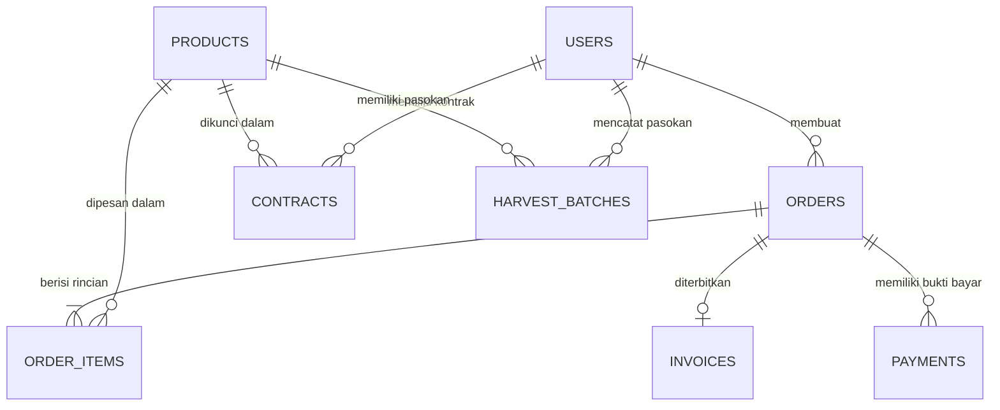
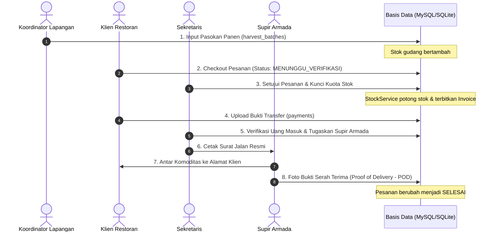

# PANDUAN LENGKAP & MENDALAM BACKEND AGROORDER GPA
### Khusus Pemula IT, Siswa RPL, & Calon Backend Developer

> **Proyek:** AgroOrder GPA — Enterprise Agricultural Supply Chain & B2B E-Commerce  
> **Framework:** Laravel 12.0 (PHP 8.2+)  
> **Database:** Relasional (MySQL / SQLite)  
> **Dokumentasi ini ditulis agar:** Siapapun yang baru pertama kali belajar pemrograman backend dapat memahami cara kerja setiap baris kode, fungsi, logika database, dan alur aplikasi ini dari hulu ke hilir.

---

## 📑 DAFTAR ISI

1. [Bab 1: Konsep Dasar Backend untuk Pemula Mutlak](#bab-1-konsep-dasar-backend-untuk-pemula-mutlak)
2. [Bab 2: Peta Folder & Struktur Proyek AgroOrder GPA](#bab-2-peta-folder--struktur-proyek-agroorder-gpa)
3. [Bab 3: Arsitektur Basis Data (Database) & Relasi Antar Tabel](#bab-3-arsitektur-basis-data-database--relasi-antar-tabel)
4. [Bab 4: Routing & Keamanan Hak Akses (Multi-Role RBAC Middleware)](#bab-4-routing--keamanan-hak-akses-multi-role-rbac-middleware)
5. [Bab 5: Bedah Kode Inti (Service Layer) — Jantung Logika Sistem](#bab-5-bedah-kode-inti-service-layer--jantung-logika-sistem)
   * [5.1 StockService.php (Pengelolaan Stok Terpadu)](#51-stockservicephp-pengelolaan-stok-terpadu)
   * [5.2 OrderService.php (Orkestrasi Pesanan, Nomor Urut, & Faktur)](#52-orderservicephp-orkestrasi-pesanan-nomor-urut--faktur)
   * [5.3 TataKelolaService.php (Master Freeze & Audit Trail)](#53-tatakelolaservicephp-master-freeze--audit-trail)
6. [Bab 6: Bedah Controller Utama (Alur Masuk Data hingga Respon)](#bab-6-bedah-controller-utama-alur-masuk-data-hingga-respon)
   * [6.1 ProfileController.php & Verifikasi Email](#61-profilecontrollerphp--verifikasi-email)
   * [6.2 Alur Transaksi: Klien -> Sekretaris -> Koordinator -> Armada](#62-alur-transaksi-klien---sekretaris---koordinator---armada)
7. [Bab 7: Form Request & Enums (Satpam Input & Kunci Tipe Data)](#bab-7-form-request--enums-satpam-input--kunci-tipe-data)
8. [Bab 8: Modul Cetak Dokumen Resmi (Surat Jalan, Faktur, Thermal Receipt POS)](#bab-8-modul-cetak-dokumen-resmi-surat-jalan-faktur-thermal-receipt-pos)
9. [Bab 9: Pengujian Otomatis (Automated Testing: Mengapa 184 Tests Lolos?)](#bab-9-pengujian-otomatis-automated-testing-mengapa-184-tests-lolos)
10. [Bab 10: Kamus Istilah Kodingan Laravel (Cheat Sheet Baris per Baris)](#bab-10-kamus-istilah-kodingan-laravel-cheat-sheet-baris-per-baris)
11. [Bab 11: Bocoran & Tips Menjawab Penguji Sidang UKK](#bab-11-bocoran--tips-menjawab-penguji-sidang-ukk)

---

## Bab 1: Konsep Dasar Backend untuk Pemula Mutlak

Jika Anda baru pertama kali masuk ke dunia IT, jangan khawatir. Backend pada dasarnya bekerja seperti **sistem manajemen restoran**:

```
[Pengunjung Toko] ──> [Pintu Masuk & Kasir] ──> [Pelayan / Waiter] ──> [Koki di Dapur] ──> [Gudang Bahan]
   (User / Browser)          (routes/web.php)          (Controller)          (Service Layer)        (Database/Model)
```

1. **Browser / Pengguna (Client):** Pengguna mengklik tombol *"Pesan Sekarang"* di layar monitor/HP.
2. **Route (`routes/web.php`):** Seperti resepsionis di pintu depan. Saat ada URL masuk (misal `POST /klien/pesanan`), Route memeriksa: *"URL ini harus diserahkan ke pelayan (Controller) mana?"*.
3. **Controller (`app/Http/Controllers/`):** Seperti pelayan restoran. Pelayan menerima pesanan dari tamu, memeriksa apakah tamu membawa uang, lalu membawanya ke dapur (Service). Pelayan **tidak boleh** memasak sendiri agar tidak kacau.
4. **Service Layer (`app/Services/`):** Seperti koki di dapur. Koki menghitung takaran bumbu, memotong bahan makanan, dan memastikan pesanan diolah dengan benar. Di kodingan kita, Service yang menghitung kuota stok, diskon kemitraan, dan membuat nomor faktur.
5. **Model & Database (`app/Models/` & MariaDB/SQLite):** Seperti lemari/kulkas penyimpan bahan mentah. Model mengambil data (misal: sisa stok wortel) atau menyimpan data baru (pesanan baru masuk).
6. **View (Blade `.blade.php`):** Seperti piring saji yang dihias cantik. Setelah backend selesai mengolah data, data dibungkus dalam bentuk HTML/CSS agar enak dilihat oleh pengguna di layar.

---

## Bab 2: Peta Folder & Struktur Proyek AgroOrder GPA

Buka VS Code Anda, perhatikan struktur folder utama berikut:

```
agroOrderGPA/
├── app/
│   ├── Enums/               <-- Daftar status baku (OrderStatus, PaymentMethod, UserRole)
│   ├── Http/
│   │   ├── Controllers/     <-- Tempat penerima request HTTP (dibagi per role: Klien, Sekretaris, dll)
│   │   ├── Requests/        <-- Tempat aturan validasi input form (FormRequest)
│   │   └── Resources/       <-- Pengubah data model menjadi format array / JSON rapi
│   ├── Models/              <-- Model Eloquent yang terhubung langsung ke tabel database
│   │   └── Concerns/        <-- Trait (fungsi tambahan pemformat data agar Model tetap bersih)
│   └── Services/            <-- Logika bisnis berat (StockService, OrderService, TataKelolaService)
├── database/
│   ├── migrations/          <-- Cetak biru struktur tabel database (file skema tabel)
│   └── seeders/             <-- Data awal/palsu untuk uji coba pertama kali aplikasi dijalankan
├── docs/                    <-- Dokumentasi, diagram alur, dan panduan teknis
├── resources/
│   ├── js/                  <-- Skrip interaktif Alpine.js dan komponen frontend
│   └── views/               <-- Tampilan halaman web (file Blade HTML)
├── routes/
│   ├── web.php              <-- Seluruh daftar rute/URL halaman web
│   └── auth.php             <-- Rute khusus autentikasi (login, register, reset password, OTP)
└── tests/
    └── Feature/             <-- Kumpulan tes otomatis (PHPUnit) yang menguji seluruh fitur
```

---

## Bab 3: Arsitektur Basis Data (Database) & Relasi Antar Tabel

Sistem ini memiliki **10 tabel utama** di database:



### 1. `users` (Pengguna Aplikasi)
Menyimpan identitas semua orang yang masuk ke sistem:
* `name`, `email`, `password`, `phone`, `company_name` (nama PT/Restoran), `client_type` (`B2B_KONTRAK` atau `REGULER`), dan `role` (`DIREKTUR`, `SEKRETARIS`, `KOORDINATOR`, `ARMADA`, `KLIEN`).
* `email_verified_at`: Tanggal & jam saat email akun diverifikasi.

### 2. `products` (Katalog Komoditas Hasil Tani)
Menyimpan master komoditas sayuran:
* `sku` (Kode unik barang, misal `PROD-WTL-001`), `name` (Wortel Brastagi), `unit` (`kg`), `grade` (`Grade A`), `base_price` (Harga dasar spot market), `is_active` (status tayang).

### 3. `harvest_batches` (Pencatatan Pasokan Masuk Gudang)
Catatan pasokan yang disuplai oleh petani binaan atau mitra luar:
* `product_id`: Terhubung ke produk apa.
* `supplier_name`: Nama petani / kelompok tani asal pasokan.
* `batch_date`: Tanggal panen/pasokan diterima gudang.
* `initial_quantity`: Berat awal masuk (kg).
* `available_quantity`: Berat stok yang saat ini masih tersedia di gudang.
* `inputted_by`: ID koordinator yang mencatat pasokan.

### 4. `contracts` (Perjanjian Kerjasama B2B Kemitraan)
Khusus klien restoran/hotel besar:
* Mengunci harga satuan komoditas selama masa kontrak (`fixed_price_per_kg`), kuota komitmen beli per periode (`committed_volume_per_cycle`), dan termin pembayaran tempo (`top_days`, misal 30 hari).

### 5. `orders` (Kepala Surat Pesanan)
Setiap kali ada transaksi pembelian, dibuat 1 baris data di sini:
* `order_number`: Nomor unik pesanan (contoh: `ORD-GPA-202611-0001`).
* `user_id`: Siapa klien yang membeli.
* `status`: Status pesanan (`MENUNGGU_VERIFIKASI`, `MENUNGGU_PEMBAYARAN`, `DIPROSES_GUDANG`, `DIKIRIM`, `SELESAI`, `DIBATALKAN`).
* `subtotal`, `tax_amount` (PPN), `shipping_cost` (ongkos kirim), `grand_total` (total bayar).
* `assigned_driver_id`: ID armada supir yang ditugaskan mengantar.
* `pod_photo_path`: Foto surat serah terima barang bukti pengantaran selesai.

### 6. `order_items` (Rincian Barang yang Dibeli)
Satu pesanan bisa membeli banyak sayuran:
* `order_id`: Masuk ke pesanan yang mana.
* `product_id`: Sayur apa yang dibeli.
* `ordered_qty`: Berapa kilogram.
* `unit_price`: Harga satuan saat pesanan disepakati.
* `subtotal_price`: `ordered_qty` dikali `unit_price`.

### 7. `invoices` (Faktur Tagihan Resmi)
* `invoice_number`: Nomor faktur resmi (contoh: `INV-GPA-202611-0001`).
* `due_date`: Tanggal jatuh tempo pembayaran (terutama untuk klien kontrak tempo 14–30 hari).
* `status`: Status pelunasan (`UNPAID`, `PARTIAL`, `PAID`, `OVERDUE`).

### 8. `payments` (Pencatatan Pembayaran)
* `order_id`: Tagihan untuk pesanan mana.
* `amount`: Jumlah uang yang dibayarkan.
* `payment_channel`: Rekening tujuan (BCA, Mandiri, BRI, QRIS, atau Kas Tunai).
* `proof_photo_path`: Foto struk bukti transfer dari klien.
* `status`: Status persetujuan bukti bayar (`MENUNGGU_VERIFIKASI`, `DISETUJUI`, `DITOLAK`).

---

## Bab 4: Routing & Keamanan Hak Akses (Multi-Role RBAC Middleware)

Buka file [`routes/web.php`](file:///d:/UKK/agroOrderGPA/routes/web.php).

### Bagaimana Sistem Mencegah Supir Armada Membuka Halaman Direktur?
Di Laravel, kita menggunakan **Middleware**:

```php
// Contoh di routes/web.php
Route::middleware(['auth', 'role:DIREKTUR'])->prefix('direktur')->name('direktur.')->group(function () {
    Route::get('/dashboard', [DashboardController::class, 'index'])->name('dashboard');
    Route::get('/tata-kelola', [TataKelolaController::class, 'index'])->name('tata-kelola.index');
});
```

* **`auth`**: Memeriksa apakah pengguna sudah login. Jika belum, lempar ke `/login`.
* **`role:DIREKTUR`**: Memeriksa kolom `role` pada akun pengguna yang login. Jika nilainya bukan `'DIREKTUR'`, Laravel otomatis menolak dengan kode keamanan **`403 Forbidden`** (Akses Ditolak).
* **`prefix('direktur')`**: Menambahkan awalan URL sehingga menjadi `domain.com/direktur/dashboard`.
* **`name('direktur.')`**: Menamai rute sehingga di view cukup memanggil `route('direktur.dashboard')`.

---

## Bab 5: Bedah Kode Inti (Service Layer) — Jantung Logika Sistem

### 5.1 StockService.php (Pengelolaan Stok Terpadu)
File: [`app/Services/StockService.php`](file:///d:/UKK/agroOrderGPA/app/Services/StockService.php)

Ini adalah layanan yang bertanggung jawab memastikan stok komoditas di gudang selalu akurat dan tidak pernah minus.

#### Baris 13-18: Menghitung Total Stok Terpadu
```php
public function getAvailableStock(int $productId): float
{
    return (float) HarvestBatch::where('product_id', $productId)
        ->where('available_quantity', '>', 0)
        ->sum('available_quantity');
}
```
* **Penjelasan Baris per Baris:**
  * Komputer mencari ke tabel `harvest_batches` untuk komoditas tertentu (`where product_id`).
  * Hanya mengambil pasokan yang stoknya masih tersisa di atas 0 (`where available_quantity > 0`).
  * Fungsi `sum('available_quantity')` menjumlahkan seluruh pasokan yang ada di gudang menjadi satu angka total stok terpadu.

#### Baris 49-80: Memotong Stok Saat Pesanan Disetujui
```php
public function allocateStock(int $productId, float $quantityToDeduct): void
{
    // 1. Ambil batch pasokan dari tanggal terlama dengan kunci gembok database
    $harvestBatches = HarvestBatch::where('product_id', $productId)
        ->where('available_quantity', '>', 0)
        ->orderBy('batch_date', 'asc')
        ->orderBy('id', 'asc')
        ->lockForUpdate() // <--- Gembok pesimistik: tidak boleh diubah user lain saat transaksi berjalan!
        ->get();

    $remainingQuantityToDeduct = $quantityToDeduct;

    // 2. Potong stok dari pasokan yang tersedia sampai jumlah kebutuhan terpenuhi
    foreach ($harvestBatches as $batch) {
        if ($remainingQuantityToDeduct <= 0) {
            break; // Kebutuhan sudah lunas terpenuhi, berhenti potong
        }

        $currentAvailable = (float) $batch->available_quantity;
        $deductionAmount = min($currentAvailable, $remainingQuantityToDeduct);

        // Kurangi stok pasokan ini secara langsung dan aman
        $batch->decrement('available_quantity', $deductionAmount);
        $remainingQuantityToDeduct -= $deductionAmount;
    }

    // 3. Jika stok di gudang ternyata kurang dari pesanan, batalkan dan lempar pesan error
    if ($remainingQuantityToDeduct > 0) {
        throw new Exception("Stok fisik komoditas di gudang tidak mencukupi untuk dialokasikan.");
    }
}
```

---

### 5.2 OrderService.php (Orkestrasi Pesanan, Nomor Urut, & Faktur)
File: [`app/Services/OrderService.php`](file:///d:/UKK/agroOrderGPA/app/Services/OrderService.php)

#### Baris 31-56: Pencegahan Tabrakan Nomor Pesanan (Race Conditions)
```php
public function generateOrderNumber(): string
{
    $prefix = 'ORD-GPA-' . date('Ym') . '-'; // Contoh hasil: ORD-GPA-202611-

    // Mengunci proses selama 5 detik menggunakan Cache Lock
    return Cache::lock('order_number_sequence_lock', 5)->block(3, function () use ($prefix) {
        $lastOrder = Order::where('order_number', 'LIKE', $prefix . '%')
            ->orderBy('id', 'desc')
            ->first();

        $nextNumber = 1;
        if ($lastOrder) {
            $lastSequence = (int) substr($lastOrder->order_number, -4);
            $nextNumber = $lastSequence + 1; // Ambil nomor terakhir lalu tambah 1
        }

        $candidateNumber = $prefix . str_pad((string) $nextNumber, 4, '0', STR_PAD_LEFT);

        // Jika nomor sudah terpakai di database, geser ke nomor berikutnya
        while (Order::where('order_number', $candidateNumber)->exists()) {
            $nextNumber++;
            $candidateNumber = $prefix . str_pad((string) $nextNumber, 4, '0', STR_PAD_LEFT);
        }

        return $candidateNumber;
    });
}
```
* **Mengapa butuh `Cache::lock`?**  
  Bayangkan ada 2 pembeli menekan tombol bayar di detik yang sama persis: `12:00:00.125`. Tanpa penguncian ini, kedua pembeli bisa mendapatkan nomor `ORD-GPA-202611-0005` yang sama dan database akan error (*duplicate entry*). Dengan `Cache::lock`, sistem melayani pembeli pertama dulu, baru pembeli kedua mendapat nomor `0006`.

#### Baris 150-198: Persetujuan Pesanan oleh Sekretaris
```php
public function approveOrder(int $orderId, int $secretaryId): Order
{
    return DB::transaction(function () use ($orderId, $secretaryId) {
        $order = Order::with('orderItems')->lockForUpdate()->findOrFail($orderId);

        // Alokasikan stok gudang untuk setiap item sayur yang dibeli
        foreach ($order->orderItems as $item) {
            $this->stockService->allocateStock($item->product_id, (float) $item->ordered_qty);
        }

        // Otomatis terbitkan faktur invoice jika belum ada
        if (!$order->invoice_id) {
            $invoiceNumber = $this->generateInvoiceNumber();
            $invoice = Invoice::create([
                'order_id' => $order->id,
                'user_id' => $order->user_id,
                'invoice_number' => $invoiceNumber,
                'issue_date' => now()->toDateString(),
                'due_date' => now()->addDays(30)->toDateString(),
                'grand_total' => $order->grand_total,
                'status' => 'UNPAID',
            ]);
            $order->invoice_id = $invoice->id;
        }

        $order->status = OrderStatus::MENUNGGU_PEMBAYARAN->value;
        $order->verified_by = $secretaryId;
        $order->save();

        return $order;
    });
}
```
* **Apa itu `DB::transaction()`?**  
  Ini adalah jaring pengaman berprinsip **"Semua Berhasil atau Semua Batal" (ACID Transaction)**. Jika di tengah jalan saat memotong stok tiba-tiba server mati atau kuota kurang, maka pesanan dan invoice tidak akan tersimpan separuh-separuh. Seluruh database dikembalikan (*rollback*) ke kondisi semula.

---

### 5.3 TataKelolaService.php (Master Freeze & Audit Trail)
File: [`app/Services/TataKelolaService.php`](file:///d:/UKK/agroOrderGPA/app/Services/TataKelolaService.php)

* **Master Freeze Darurat:** Sakelar darurat milik Direktur. Saat diaktifkan (`master_freeze_active = true`), seluruh klien di sistem otomatis dicegah checkout pesanan baru, berguna saat terjadi audit stok opname tahunan atau kondisi darurat gagal panen massal.
* **Audit Trail Immutable:** Setiap perubahan kebijakan tata kelola disimpan ke dalam file audit khusus berformat JSON yang dilengkapi *checksum hash* SHA256. Jika ada seseorang yang mencoba memanipulasi file log secara ilegal di server, sistem akan mendeteksi ketidakcocokan hash dan membunyikan alarm peringatan.

---

## Bab 6: Bedah Controller Utama (Alur Masuk Data hingga Respon)

### 6.1 ProfileController.php & Verifikasi Email
File: [`app/Http/Controllers/ProfileController.php`](file:///d:/UKK/agroOrderGPA/app/Http/Controllers/ProfileController.php)

Baru saja kita menambahkan fitur verifikasi email langsung di halaman edit profil:

```php
// Memverifikasi alamat email pengguna secara instan langsung dari formulir profil
public function verifyEmailDirectly(Request $request): RedirectResponse
{
    $user = $request->user(); // 1. Ambil siapa user yang sedang login
    if (!$user->hasVerifiedEmail()) { // 2. Periksa apakah sudah terverifikasi sebelumnya
        $user->markEmailAsVerified(); // 3. Set kolom email_verified_at = now() di database
    }

    // 4. Kembalikan ke halaman edit profil dengan pesan sukses
    return Redirect::route('profile.edit')->with('status', 'email-verified-directly');
}
```
* Di view [`profile/edit.blade.php`](file:///d:/UKK/agroOrderGPA/resources/views/profile/edit.blade.php):
  Jika `$user->hasVerifiedEmail()` bernilai `false`, sistem menampilkan tombol merah/kuning bertuliskan **`[✓ Verifikasi Sekarang]`**. Saat diklik, tombol ini mengeksekusi route POST `/profile/verify-email-now` di atas dan halaman langsung ter-refresh dengan status hijau **`TERVERIFIKASI OTP`**.

---

### 6.2 Alur Transaksi Lengkap: Dari Petani hingga Diterima Klien

Berikut alur perjalanan data dari awal hingga selesai:



1. **Koordinator:** Mengisi form penerimaan sayur di `/koordinator/stok`. Database mencatat berat panen masuk dan menambahkan ketersediaan stok fisik gudang.
2. **Klien:** Membuka etalase `/klien/pesanan/create`, memilih sayuran, lalu checkout. Pesanan berstatus `MENUNGGU_VERIFIKASI`.
3. **Sekretaris:** Membuka antrean `/sekretaris/verifikasi`. Mengklik tombol hijau **"Setujui"**. Di balik layar, `OrderService@approveOrder` memotong stok gudang dan menerbitkan Nomor Faktur Tagihan resmi.
4. **Klien:** Membayar tagihan dan mengunggah foto struk transfer di `/klien/pesanan/{id}`.
5. **Sekretaris:** Membuka `/sekretaris/pembayaran`, mencocokkan mutasi bank, klik **"Setujui Pembayaran"**, lalu menugaskan supir armada di menu `/sekretaris/surat-jalan`.
6. **Armada:** Membuka HP, melihat surat jalan pengantaran sayur, memuat sayur ke mobil bak/truk, lalu mengantar ke gudang restoran klien.
7. **Penyelesaian (POD):** Di lokasi klien, supir armada dan manajer dapur klien mengecek fisik sayur. Supir memfoto dokumen tanda terima fisik (*Proof of Delivery*) di menu armada. Status pesanan berubah menjadi `SELESAI`.

---

## Bab 7: Form Request & Enums (Satpam Input & Kunci Tipe Data)

### Apa itu Form Request?
Buka contoh di [`app/Http/Requests/PerbaruiProfilRequest.php`](file:///d:/UKK/agroOrderGPA/app/Http/Requests/PerbaruiProfilRequest.php).  
Form Request bertindak sebagai **"Satpam Pintu Masuk"**. Sebelum data sampai ke Controller, satpam ini menggeledah:
* Apakah nama kosong? (`required`)
* Apakah format email salah? (`email`)
* Apakah nomor HP kepanjangan? (`max:20`)

Jika ada 1 data saja yang salah, satpam langsung menolak dan mengembalikan pengguna ke halaman formulir lengkap dengan pesan error berwarna merah di bawah input terkait. Controller tidak perlu lagi dipusingkan oleh puluhan baris `if (!isset(...))`.

### Apa itu Enum?
Buka [`app/Enums/OrderStatus.php`](file:///d:/UKK/agroOrderGPA/app/Enums/OrderStatus.php).
```php
enum OrderStatus: string
{
    case MENUNGGU_VERIFIKASI = 'MENUNGGU_VERIFIKASI';
    case MENUNGGU_PEMBAYARAN = 'MENUNGGU_PEMBAYARAN';
    case DIPROSES_GUDANG     = 'DIPROSES_GUDANG';
    case DIKIRIM             = 'DIKIRIM';
    case SELESAI             = 'SELESAI';
    case DIBATALKAN          = 'DIBATALKAN';
}
```
* Di PHP jadul, orang sering mengetik manual teks seperti `'selesai'`, `'SELESAI'`, atau `'lunas'`. Kalau salah ketik satu huruf saja (`'seleasi'`), sistem langsung rusak.
* Dengan **Enum di PHP 8.2+**, nilainya dikunci secara kaku oleh bahasa pemrograman. Anda tidak bisa memasukkan status di luar 6 status resmi di atas.

---

## Bab 8: Modul Cetak Dokumen Resmi (Surat Jalan, Faktur, Thermal Receipt POS)

Aplikasi AgroOrder GPA memiliki modul cetak dokumen siap pakai:
1. **Surat Jalan Pengiriman (`/cetak/surat-jalan`):** Format resmi A4 lengkap dengan identitas supir, pelat nomor kendaraan, jam keberangkatan, dan kolom tanda tangan basah penerima gudang.
2. **Faktur / Invoice Penjualan (`/cetak/faktur/{id}`):** Format A4 komersial yang memuat rincian harga per kg, PPN 0% fasilitas pertanian DTP, tanggal jatuh tempo, dan rekening pembayaran koperasi.
3. **Struk Thermal Kasir POS (`/cetak/struk/{id}`):** Didesain khusus untuk printer kasir mini (lebar kertas 58mm atau 80mm). Menggunakan font monospace ramping, hemat kertas, dan memuat QR Code transaksi.
4. **Berita Acara Retur Fisik (`/cetak/berita-acara-retur`):** Dokumen resmi apabila ada sayuran yang rusak di perjalanan untuk proses klaim ganti rugi.

---

## Bab 9: Pengujian Otomatis (Automated Testing: Mengapa 184 Tests Lolos?)

Buka terminal di folder proyek, jalankan:
```bash
php artisan test
```
Hasilnya:
```
Tests:    184 passed (718 assertions)
Duration: 13.09s
```

### Mengapa Automated Test Sangat Hebat di Mata Penguji?
* Sebagian besar siswa/pembuat web menguji web secara manual dengan mengklik tombol satu per satu di browser. Jika webnya memiliki 100 fitur, mereka butuh waktu berjam-jam untuk mengetes ulang setiap ada perubahan kode.
* Di AgroOrder GPA, kita memiliki **184 skrip robot penguji otomatis**. Hanya dalam **13 detik**, robot ini menguji:
  1. Apakah ada celah keamanan SQL Injection? (Aman)
  2. Apakah ada celah Cross-Site Scripting (XSS)? (Aman)
  3. Apakah dua orang bisa merebut stok sayur yang sama bersamaan? (Dicegah dengan aman)
  4. Apakah supir bisa masuk ke halaman direktur? (Ditolak dengan benar)
  5. Apakah tombol verifikasi email di edit profil berfungsi? (Berhasil)

---

## Bab 10: Kamus Istilah Kodingan Laravel (Cheat Sheet Baris per Baris)

| Perintah Kode | Arti & Fungsinya dalam Bahasa Manusia |
| :--- | :--- |
| `DB::transaction(function() { ... })` | Mengunci seluruh perintah database dalam satu transaksi aman. Jika ada satu error, semua dibatalkan (*rollback*). |
| `->lockForUpdate()` | Mengunci baris database agar user lain tidak bisa mengubah stok di detik yang sama (*anti-overselling*). |
| `Cache::lock('kunci', 5)` | Mencegah tombol diklik ganda secara cepat (*anti-double-click*) dan menjamin nomor faktur unik. |
| `compact('user', 'order')` | Membungkus variabel di Controller untuk dikirim ke tampilan file Blade. |
| `redirect()->route('...')->with('status', '...')` | Mengarahkan user ke halaman lain sambil membawa pesan notifikasi kilat (*flash message*). |
| `session('status')` | Mengambil dan menampilkan pesan kilat yang dikirim dari controller di file blade. |
| `old('email', $user->email)` | Menjaga agar tulisan di kotak formulir tidak hilang saat formulir gagal divalidasi. |
| `@csrf` | Token keamanan wajib di setiap form HTML untuk mencegah pembajakan formulir dari web asing. |
| `$user->hasVerifiedEmail()` | Memeriksa apakah kolom `email_verified_at` di tabel database sudah terisi tanggal verifikasi atau masih null. |
| `$user->markEmailAsVerified()` | Mengisi tanggal dan waktu saat ini (`now()`) ke dalam kolom `email_verified_at` di database. |

---

## Bab 11: Bocoran & Tips Menjawab Penguji Sidang UKK

Jika Anda ditanya oleh penguji saat presentasi, gunakan contekan jawaban cerdas berikut:

#### Q1: "Coba jelaskan alur MVC di aplikasi kamu saat Klien membeli sayur!"
> **Jawaban:**  
> *"Saat Klien menekan tombol checkout, URL `POST /klien/pesanan` ditangkap oleh `routes/web.php`. Route meneruskannya ke `PesananController@store`. Controller memanggil `OrderService` untuk menghitung total belanja dan mengunci kuota stok gudang melalui `StockService`. Setelah data pesanan dan rincian itemnya tersimpan di database via model `Order` dan `OrderItem`, Controller mengembalikan tampilan view Blade berisi konfirmasi pesanan dengan nomor order unik."*

#### Q2: "Kenapa kodingan logikanya dipisah ke folder `app/Services`, kenapa tidak langsung di Controller saja?"
> **Jawaban:**  
> *"Untuk mematuhi prinsip Clean Code yaitu Single Responsibility Principle. Controller hanya bertugas menangani request dari browser dan mengembalikan respon view atau JSON. Seluruh proses perhitungan rumit seperti penomoran faktur otomatis, pemotongan kuota stok panen, dan kalkulasi plafon kredit ditaruh di Service Layer. Hasilnya, kode lebih rapi, tidak terjadi Fat Controller, dan sangat mudah diuji lewat Automated Testing."*

#### Q3: "Bagaimana sistem kamu memastikan stok sayur di database tidak menjadi minus saat diserbu banyak pembeli?"
> **Jawaban:**  
> *"Kami menggunakan Pessimistic Row Locking dengan fungsi `lockForUpdate()` di dalam blok `DB::transaction()` pada file `StockService.php`. Saat ada transaksi yang sedang memotong stok, database akan menggembok baris data tersebut sampai transaksi pertama selesai. Jika sisa stok fisik tidak mencukupi kuantitas pesanan, sistem langsung melempar Exception sehingga transaksi dibatalkan secara otomatis sebelum stok sempat menjadi minus."*

#### Q4: "Bagaimana keamanan autentikasi dan otorisasi di web ini?"
> **Jawaban:**  
> *"Kami menerapkan Multi-Role RBAC (Role-Based Access Control) menggunakan middleware khusus di `routes/web.php` yang mengecek role akun login (Direktur, Sekretaris, Koordinator, Armada, Klien). Setiap form dilindungi token `@csrf` untuk mencegah serangan CSRF, input pengguna disaring oleh FormRequest dan escaping blade `{{ ... }}` untuk mencegah XSS, serta seluruh query database menggunakan Eloquent Prepared Statements untuk mencegah SQL Injection."*

---

*Dokumentasi ini disusun secara komprehensif untuk proyek **AgroOrder GPA**.*  
*Simpan file ini baik-baik sebagai pegangan belajar dan referensi materi saat demonstrasi di hadapan penguji UKK.*
